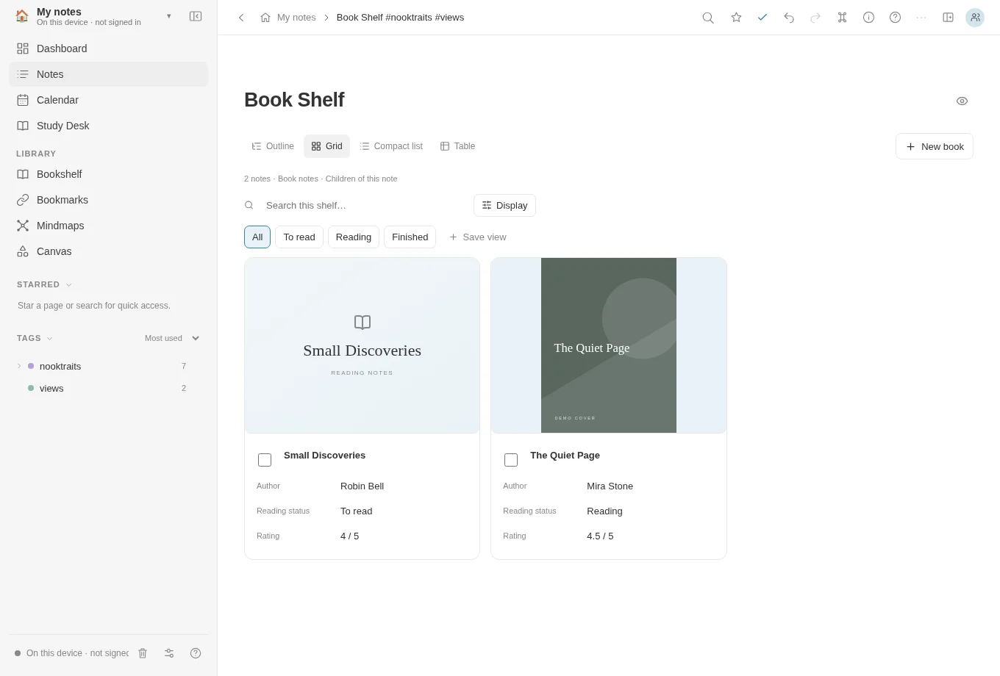
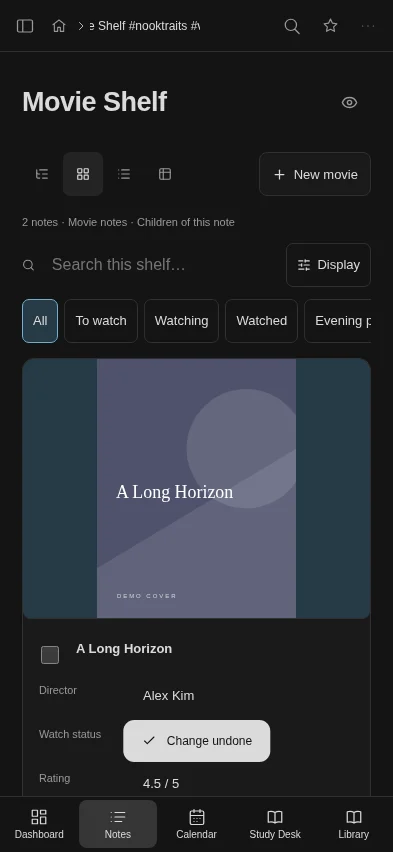
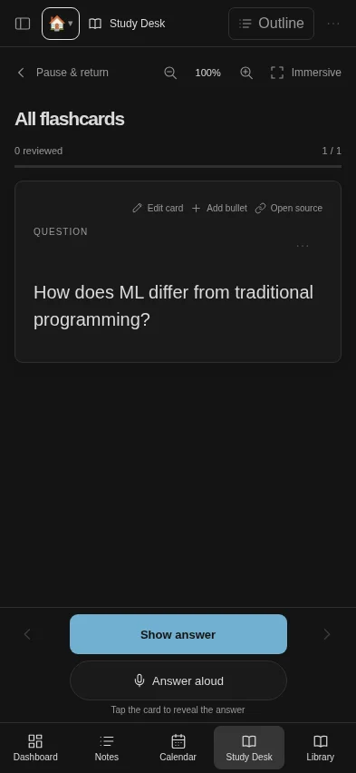
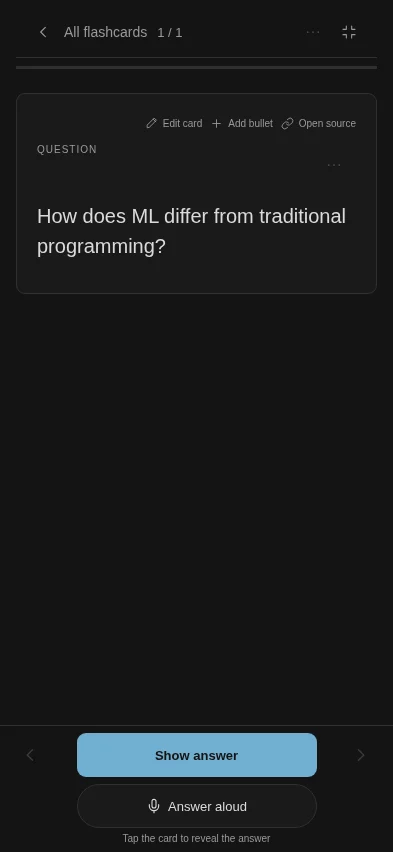

# NookTraits shelf review — 24 November 2026

Reviewed the shipped web staging implementation using Book Shelf and Movie Shelf
workflows and the official [Bases introduction](https://help.obsidian.md/bases)
and [view documentation](https://help.obsidian.md/bases/views).

Bases separates original notes/properties from saved presentations. It provides
named views, item creation/search, image cards, typed filters and independent
view configuration. RemoNook should adopt those useful interactions while keeping
bullets, normal undo, offline persistence and concurrent-edit history as its source.
It does not claim `.base` file compatibility or complete Bases feature parity.

## Findings and implementation

- `#nooktraits` incorrectly enabled the collection layout controls as well as
  fields. It did not actually append `#views`, but behaved as though it had.
  Require `#views` explicitly for collection layouts; NookTraits alone adds only
  traits and the heading eye. Both tags opt a bullet into a trait collection.
  Do not strip existing user tags or discard retained view configuration.
- The study dock puts two buttons into a single fixed-height grid. Move voice
  answering into a separate, naturally sized secondary row and keep the active
  voice panel in the same dock, separate from navigation and the hint.
- A shelf cannot create its own records. Add a small New note form, create one
  original child through normal persistence, preserve append order and existing
  children, and use the current type/status where applicable. One undo removes
  the insertion. Failed saves retain the form.
- Book presets exist but Movies lack equivalent status views. Add To watch,
  Watching and Watched, with relevant fields/columns for both shelf types.
- Add optional cover/poster URLs and use existing local image attachments where
  available. Cards retain a quiet typographic fallback when images fail or are
  absent. No metadata API, automatic external search or paid service is involved.
- Add collection search, relevant property choices, typed multi-condition filters
  (all/any), saved user-named views with independent layout/columns/filter/sort,
  and device-local restoration of the active view after hide/show or reload.
- Keep collection membership independent from note positions and study types.
  Scope (children/descendants/workspace) and type are explicit, common to a shelf;
  view-specific filtering, layout and presentation do not relocate notes.

## Data and durability

Extend the existing version-1 `web.nookTraits.views` append-only configuration
revisions. Existing single-condition views remain readable. Archive named views
by a new revision rather than deleting history. Existing values, definitions,
assignments and field memberships remain intact. New records and metadata edits
use the existing serialized save path, undo and v3 durable outbox. No backend
migration, snapshot replacement or conflict/overwrite UI.

## Validation and remaining differences

Exercise both complete shelf flows, tag independence, save failures, duplicate
clicks, original identity/append order/undo, filters including empty/false/zero,
named-view isolation/recovery, covers/fallbacks, and mobile/immersive dock geometry.
Check light/dark and narrow/short viewports. Release web staging only.

Further Bases capabilities remain separate work: arbitrary custom types, nested
filter groups, multiple sort keys, grouping, formulas, rollups, CSV export and
column drag/reorder. A source-note jump remains the full note editor; the shelf
is an editable view of originals, not another database copy.

## Try the two example workflows

**Book Shelf:** create `Book Shelf #nooktraits #views`, select Grid, then Set up
Book Shelf (or Display → Note type → Book). Scope stays on this note’s children.
Use New book, edit Author/Reading status/Rating, and open the original note for
More traits → Cover image. To read, Reading and Finished remain independent
views of those same originals. Set a rating filter and use Save view for a
reading shortlist.

**Movie Shelf:** create `Movie Shelf #nooktraits #views`, select Grid and Set up
Movie Shelf. Add a movie with New movie; use To watch, Watching or Watched. The
new item adopts the active status. Its own note supports Director, Rating,
Poster image, Release year and Genre. Save an Evening picks view with rating
greater than 4; choose Table for that view while keeping All as cards.

Manually created existing items need their own explicit `#nooktraits/book` or
`#nooktraits/movie` tag. Ordinary child notes are still visible in Outline but
are not silently converted into typed shelf records. New shelf notes are
explicitly tagged by that user action. Cover URLs are supplied by the user;
metadata and artwork are not automatically downloaded from a movie/book API.

## Browser evidence

These are real Chromium renders using fictional books/movies and synthetic
cover images. The voice-layout fixture uses the actual StudyDesk component in
the app shell with a synthetic signed-in capability, not a real customer account.
No transcription or grading API calls were made during these layout checks.

| Book Shelf | Movie Shelf on mobile |
| --- | --- |
|  |  |

| Normal mobile study | Immersive study |
| --- | --- |
|  |  |

## Verification

Application source `ccf77f80b10ddfae25d65f4c5d2ff61bfc4e167d` passed local
TypeScript/build and **699 automated tests**, and
[CI](https://github.com/renx777/remonook/actions/runs/45441065085).
Browser checks exercised both shelf workflows, relevant fields, image/fallback
rendering, filters, named views and independent layouts, creation/undo, hide/show,
reload and mobile light/dark fit, with no runtime errors. The separate real-UI
flow starts from an empty guest workspace without importing/seeding application
state and exercises both complete shelves.

Voice geometry passed normal and immersive study at 393×852 and 393×640: the
secondary action stays below Show answer, above the hint and clear of navigation.
Permission-denial handling and normal reveal passed without AI calls. Entering
card editing also closes voice review before the dock becomes inert. Physical
phone microphone recording/transcription was not exercised by this environment.

Model/UI/app checks cover tag independence, append order and original identity,
one-undo creation, failed-save draft retention, repeated-click locking, safe
filter defaults/empty/zero/false semantics, old single-filter configs, relevant
property menus, per-account view restoration, rapid configuration edits, and
retention of independently created views after concurrent offline edits.

The [web staging release](https://github.com/renx777/remonook/actions/runs/45441157277)
passed its build/regressions, backend compatibility/health, end-to-end sync and
live link-collection checks. A separate deployed mobile guest smoke passed both
complete shelf flows, explicit tag removal/restoration, saved views/layout after
reload, hide/show, Author persistence, status/source isolation, search and viewport
fit, with no runtime errors. HTTPS browser smoke used the managed environment’s
proxy certificate exception; app TLS settings were not changed.

Live source is recorded in [ENVIRONMENTS.md](ENVIRONMENTS.md). No native release,
sync Worker deployment, main merge or production deployment was made.
