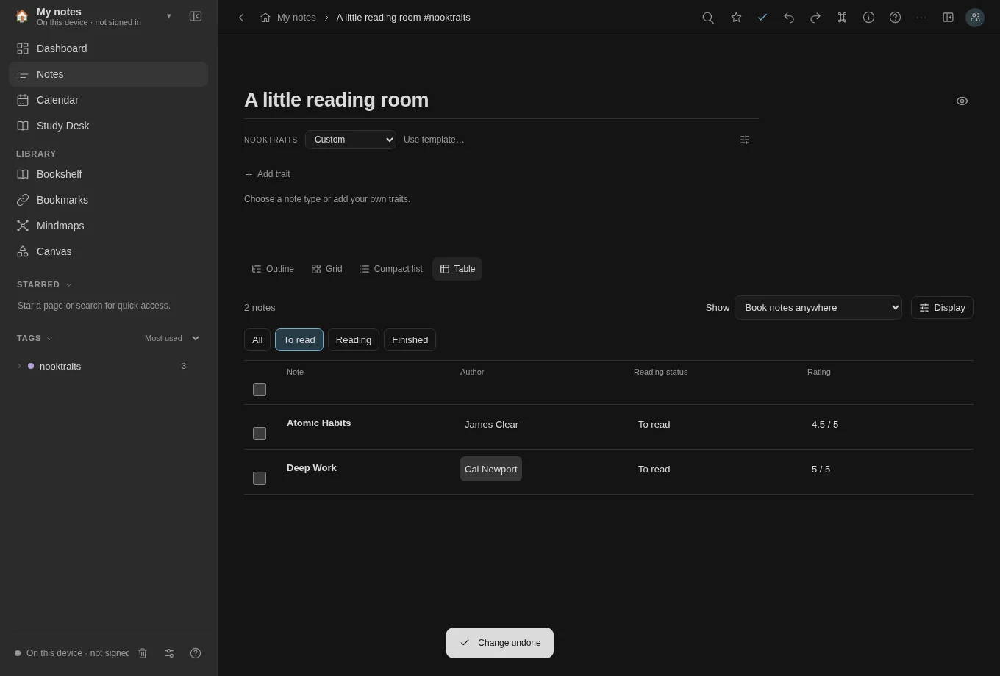
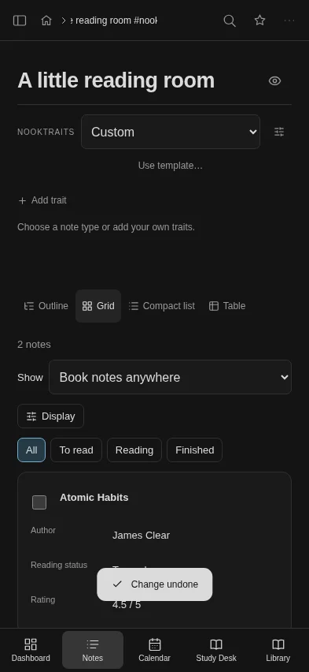

# NookTraits — web staging

A bullet opts in only through `#nooktraits` or a known shortcut such as
`#nooktraits/book`. Normal topic tags do not activate it. The existing bullet kind,
study type, outline location and content remain independent of the optional type.
Book, Project, Meeting, Movie, Person, Research paper and Custom are starters.

The eye sits beside the bullet heading, including the zoomed heading. Visibility
is device-local and scoped to account/workspace/source note; mirrors share it.
Hiding removes trait controls and their spacing, presenting the ordinary outline
without changing saved collection configuration. Study presentation hides traits
without changing that preference. Removing the tag deactivates the feature but
retains values, schema assignments and history; reactivation restores them.

The first delivery connects inline, buffered field edits to ordinary persistence,
undo and v3 sync. Definition/value histories remain append-only in the existing
`web.noteProperties`. Additive `web.nookTraits` revision maps store type assignments,
per-note field membership and per-type shared fields. Type-specific Status fields
have separate stable IDs. Starter IDs/options are deterministic across offline
clients. Existing property data is retained and offered on activation. Defaults
fill only never-edited cells, preserving explicit clears, false and zero.

Types describe fields; templates supply starting content. Templates retain type
and field membership when their text explicitly opts in. Applying a type does not
rewrite the note body or create another note. Due date and task completion use
adapters over the existing bullet fields; created/updated times are derived.

Collection table/cards/list views reference original activated notes. Sources are
children, descendants or the workspace, optionally filtered by type. Named Book
views (All, To read, Reading, Finished), typed filtering/sorting, selectable columns,
inline editing and one-undo bulk edits share the same mutations as a note editor.
Sorting never changes outline positions. Account guards prevent cross-workspace writes; failed-save editors retain their
drafts while open. Unsaved field drafts are not persisted across closing/reload. No snapshot replacement,
outbox change, conflict-resolution or force-overwrite UI is introduced.

Verification covers activation/code/link boundaries, legacy data, mirror identity,
field applicability, concurrent revisions, safe defaults, canonical due/task fields,
queries and unchanged outline order, hide/show persistence/isolation, heading eye
alignment, failed saves, keyboard/mobile behavior, template retention and bulk undo.
Release only through the web staging workflow. No native binaries, backend Worker
or production deployments in this task. Formulas, rollups, arbitrary automation
and additional view layouts are later work.

## Try it

1. Add `#nooktraits/book` to a book bullet, or use **Add NookTraits** in its
   action menu and choose **Book**. Ordinary `#book` remains a topic tag.
2. Zoom into the bullet to edit Author, Reading status, Rating and other fields.
   **Add trait** reuses an existing definition or creates one. Sharing it across
   a type is an explicit checkbox. Removing a field keeps its value/history.
3. Use the eye on the heading line for a clean outline while writing or studying.
   Tap it again to restore fields and the selected collection view.
4. For a reading collection, tag its parent `#nooktraits`, choose **Table** or
   **Grid**, then **Show → Book notes anywhere**. Book tabs are All, To read,
   Reading and Finished. **Display** chooses columns, a filter and sort order.
5. Edit cells directly. Select multiple notes to set one trait in a single undo
   step. Open a note title to return to its original outline location.

**Manage NookTraits** retains definition rename/archive and value history. Type
selection changes relevant fields, not the bullet’s study kind or location.
URL/date-time are additional field types. Due date and Completed are available
through Add trait and edit the existing scheduling/task values.

Limits inherited from typed properties: 64 active definitions per workspace,
128 choices per select, 8,000 characters per text value. Collection pages render
30 originals at a time. This first version offers one typed filter plus one sort,
saved independently for each named Book view. It does not introduce formulas,
rollups or arbitrary user-defined types. Imported tagged Books default to To read
until explicitly changed or cleared.

## Browser captures

Real Chromium renders using synthetic device-local notes; no customer data.
Desktop/mobile light and dark, same-line heading eye, and editable collections:

| Desktop | Mobile dark |
| --- | --- |
|  |  |

| Table | Mobile cards |
| --- | --- |
|  |  |
