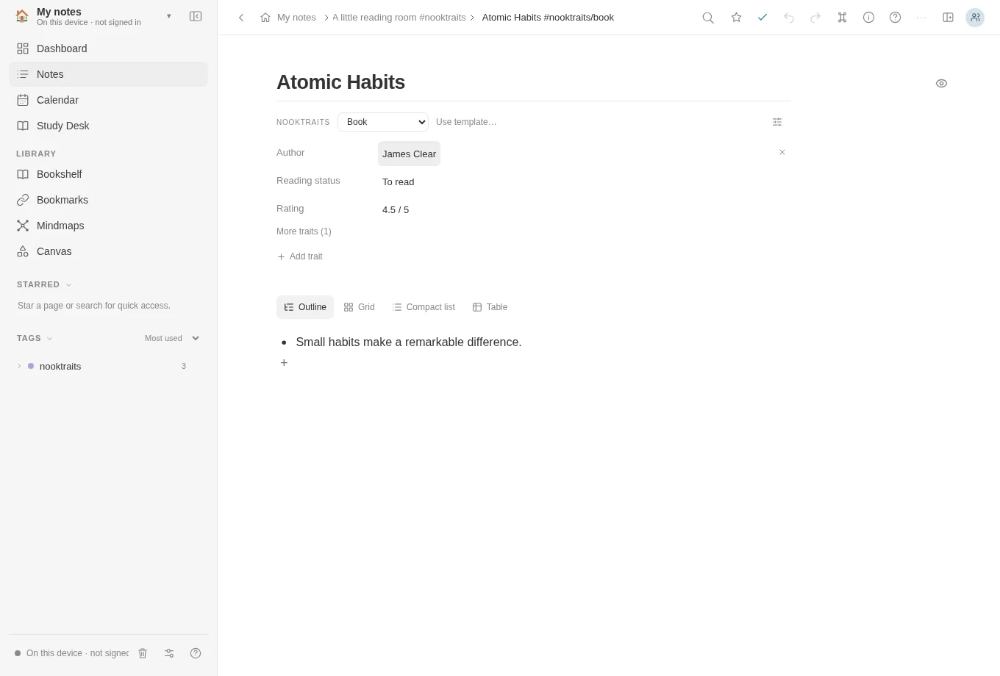
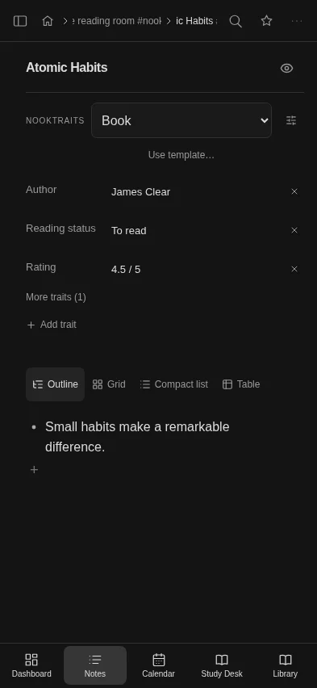

# NookTraits — web staging

A bullet opts in only through `#nooktraits` or a known shortcut such as
`#nooktraits/book`. Normal topic tags do not activate it. The existing bullet kind,
study type, outline location and content remain independent of the optional type.
Book, Project, Meeting, Movie, Person, Research paper and Custom are starters.
`#nooktraits` enables fields only. Add `#views` explicitly to also enable collection
layouts; neither activation nor choosing a type appends that tag. Plain `#views`
continues to provide ordinary child collections without NookTraits.

The eye sits beside the bullet heading, including the zoomed heading. Visibility
is device-local and scoped to account/workspace/source note; mirrors share it.
Hiding removes trait controls and their spacing, presenting the ordinary outline
without changing saved collection configuration. Study presentation hides traits
without changing that preference. Removing the tag deactivates the feature but
retains values, schema assignments and history; reactivation restores them.

The first delivery connects inline, buffered field edits to ordinary persistence,
undo and v3 sync. Definition/value histories remain append-only in the existing
`web.noteProperties`. Additive `web.nookTraits` revision maps store type assignments,
per-note field membership and per-type shared fields. Type-specific Status fields
have separate stable IDs. Starter IDs/options are deterministic across offline
clients. Existing property data is retained and offered on activation. Defaults
fill only never-edited cells, preserving explicit clears, false and zero.

Types describe fields; templates supply starting content. Templates retain type
and field membership when their text explicitly opts in. Applying a type does not
rewrite the note body or create another note. Due date and task completion use
adapters over the existing bullet fields; created/updated times are derived.

Collection table/cards/list views reference original activated notes. Sources are
children, descendants or the workspace, optionally filtered by type. Named Book
views (All, To read, Reading, Finished), typed filtering/sorting, selectable columns,
inline editing, creation of original children and one-undo bulk edits share the same mutations as a note editor.
Sorting never changes outline positions. Account guards prevent cross-workspace writes; failed-save editors retain their
drafts while open. Unsaved field drafts are not persisted across closing/reload. No snapshot replacement,
outbox change, conflict-resolution or force-overwrite UI is introduced.

Verification covers activation/code/link boundaries, legacy data, mirror identity,
field applicability, concurrent revisions, safe defaults, canonical due/task fields,
queries and unchanged outline order, hide/show persistence/isolation, heading eye
alignment, failed saves, keyboard/mobile behavior, template retention and bulk undo.
Release only through the web staging workflow. No native binaries, backend Worker
or production deployments in this task. Formulas, rollups, arbitrary automation
and additional view layouts are later work.

## Try it

1. Add `#nooktraits/book` to a book bullet, or use **Add NookTraits** in its
   action menu and choose **Book**. Ordinary `#book` remains a topic tag.
2. Zoom into the bullet to edit Author, Reading status, Rating and other fields.
   **Add trait** reuses an existing definition or creates one. Sharing it across
   a type is an explicit checkbox. Removing a field keeps its value/history.
3. Use the eye on the heading line for a clean outline while writing or studying.
   Tap it again to restore fields and the selected collection view.
4. For a reading collection, tag its parent `#nooktraits #views`, choose **Table** or
   **Grid**, then use **Set up Book Shelf** in the empty state or **Display → Note
   type → Book**. Scope defaults to children; choose descendants or workspace
   explicitly in Display. Book tabs are All, To read, Reading and Finished; Movie
   tabs are All, To watch, Watching and Watched. **New book/movie** appends an
   original child and adopts the current status. **Save view** creates a named
   view with its own layout, columns, filters and sort.
5. Edit cells directly. Select multiple notes to set one trait in a single undo
   step. Open a note title to return to its original outline location.

**Manage NookTraits** retains definition rename/archive and value history. Type
selection changes relevant fields, not the bullet’s study kind or location.
URL/date-time are additional field types. Due date and Completed are available
through Add trait and edit the existing scheduling/task values.

Limits inherited from typed properties: 64 active definitions per workspace,
128 choices per select, 8,000 characters per text value. Collection pages render
30 originals at a time. Shelves support up to eight typed conditions (match all/any), one sort key and
32 user-named views. Layout, columns, cover selection and filters are saved
independently; active view selection is remembered locally. It does not introduce formulas,
rollups or arbitrary user-defined types. Imported tagged Books default to To read
until explicitly changed or cleared.

## Your own note types, study starters and shelf tools — 24 November 2026

A review of the shipped shelves found these gaps, now addressed on branch `feat/nooktraits-upgrade`:

- **Only seven fixed types.** Every other kind of note was "Custom", and Custom notes all shared one
  field list, so sharing a trait on a recipe also put it on unrelated notes. **New type…** in the
  type menu now creates a workspace type: a name, chosen traits (reuse or create), and an optional
  single-choice trait that gives its shelves tabs. Types live in `web.nookTraits.types` as
  append-only revisions (like views), so offline edits converge and history is kept. Each type gets a
  `#nooktraits/<slug>` shortcut that never changes, so a rename does not break existing tags.
  **Edit “…” type** renames it, changes traits or archives it; archived types disappear from menus
  but notes that use them keep their traits and values. Up to 48 types, 32 traits each.
- **Nothing for students.** New starters: **Topic** (Subject, Chapter, Revision status, Confidence,
  Last revised, Next revision, Exam weightage %) and **Lecture** (Course, Teacher, Lecture date,
  Lecture status, Lecture link, Duration).
- **Shelf features hard-coded to Book and Movie.** Status tabs, **New …**, default columns, the empty
  state starters and cover fallbacks now work for every type. Project, Topic and Lecture get tabs from
  their status; your own types from their chosen tab trait. Book and Movie keep their original tab ids,
  so saved views and remembered tabs still work.
- **Creating a type from a shelf** sets what the shelf collects instead of typing the shelf note.
- **No grouping, totals or export.** Display → **Group by** any single-choice or checkbox trait
  (option order, Not set last; headings in table, grid and list). Tables show a summary row
  (average and total for numbers, “x of n” for checkboxes, set counts otherwise). **CSV** exports
  every matching note in the current view with its visible traits, as displayed (UTF-8 with BOM for
  spreadsheets; cells that start like a formula are neutralised).
- **Note pickers.** Linking a note listed every bullet, including empty ones, capped at 50; the note
  filter showed only the first 200 bullets. Both now search titled notes, NookTraits notes first.
- **Outline clutter.** A Custom note in the outline showed “add your own traits” with no way to do it
  there and an empty gap; the compact panel now shows only the type menu until the note is opened.

Scale was checked and is not a problem: on a 4,000-note workspace with 1,000 typed books, a
workspace shelf query took 14–37 ms and a full shelf render about 38 ms.

Validation: `tests/nooktraits-types.test.mjs` (types, slugs, archive, concurrent edits, tabs for user
types and Topic, defaults and explicit clears, grouping, summaries, CSV escaping, default columns);
all 705 tests pass and the build succeeds. A Chromium run created a Recipes shelf, a Recipe type with
two traits from the shelf, added items from status tabs, edited values in the table (footer
“Avg 22.5 · Sum 45”), grouped by Stage and exported CSV, at 1280×900 and 390×844, with no errors.

## Shelf images and scope

Open an item’s original note and use **More traits → Cover image / Poster image**
to set an image URL. A local attached image is also supported. Grid cards use a
quiet title fallback if no image is available or loading fails. **Display → Card
image** chooses another URL trait or turns images off. Remote images load only
when displayed; no automatic metadata API or paid provider is used.

The shelf’s scope/type applies to all its views; view filters, columns, image
selection, layout and sort stay independent. Search is transient. Named views
can be renamed or removed from Display; removal retains configuration history
and leaves the original notes untouched. All/any filters are flat groups; nested
groups, grouping and formulas remain later work. See the [review](NOOKTRAITS-REVIEW.md).

## Browser captures

Real Chromium renders using synthetic device-local notes; no customer data.
Desktop/mobile light and dark, same-line heading eye, and editable collections:

| Desktop | Mobile dark |
| --- | --- |
|  |  |

| Table | Mobile cards |
| --- | --- |
|  |  |

## Initial release validation — 24 November 2026

For the shelf follow-up and study-dock fix, see [the review](NOOKTRAITS-REVIEW.md)
and the latest [environment record](ENVIRONMENTS.md).

Application source `818b55057b71a7d9689e391fcf740382275afd63`:
- TypeScript/build and **686 automated tests passed** locally; the same application
  source also passed [CI](https://github.com/renx777/remonook/actions/runs/45428025618).
- Chromium tested desktop/mobile, light/dark, same-line eye geometry, visibility
  across reload, panel-spacing removal, field saves, one-undo bulk updates and
  retained collection source/layout, without runtime errors.
- A separate deployed-staging mobile guest flow created a tagged note through
  ordinary UI, edited Author, hid/reloaded/restored traits and checked alignment
  and viewport fit. It passed without runtime errors. The managed environment’s
  browser needed its proxy certificate exception; this does not change app TLS.
- Cross-account visibility and failed-save drafts are exercised in UI tests;
  concurrent property revisions, legacy reuse, archived starters, inline code
  preservation and explicit first-time clears are covered by model tests.

No physical Android/iPhone session was available for this web-only release.
Native app UI and binaries remain on their previous authorized release.

## Traits blocks (`#traits`)

Properties can also live in the outline itself, like Obsidian's Properties panel.

- Type `#traits` (any case) on a bullet. When the cursor leaves that bullet, the tag is removed and a child bullet **Traits** is added as its first child. The bullet menu also has **Add traits**. It shows **Show traits** when the note already has a block, and that action expands the block.
- The Traits bullet is an ordinary bullet marked `traitsBlock: true`, so it collapses, moves, syncs, undoes and copies like any other. Each of its children is one property, stored as the text `key:: value`. Older apps and exports show that text as-is.
- Rows show a type icon, the name, and the value, and are edited in place. Click the name to rename the property, change its type or delete it. Click the value to edit it. Keyboard navigation into a row still shows the raw `key:: value` text.
- Types are Text, List, Number, Checkbox, Date and Date & time. A type belongs to the property *name* across the workspace (as in Obsidian), stored as append-only revisions in `web.traitKeys[name]`. When no type has been chosen, it is inferred from the value.
- `#views` collections leave Traits blocks out of their items. They add a column for each property name their items use (the 6 most common), and use a `cover`/`poster`/`image`/`thumbnail` URL property as the card image. Cards show up to three properties. The Website, Price and Availability columns appear only when an item has a link, or when no item has properties.
- Flashcards never use a Traits block as part of an answer.

Code: `src/traits-block.mjs` (model, pure edits), `src/TraitsBlock.tsx` (outline rows), `src/traits-block.css`, tests in `tests/traits-block.test.mjs`.
