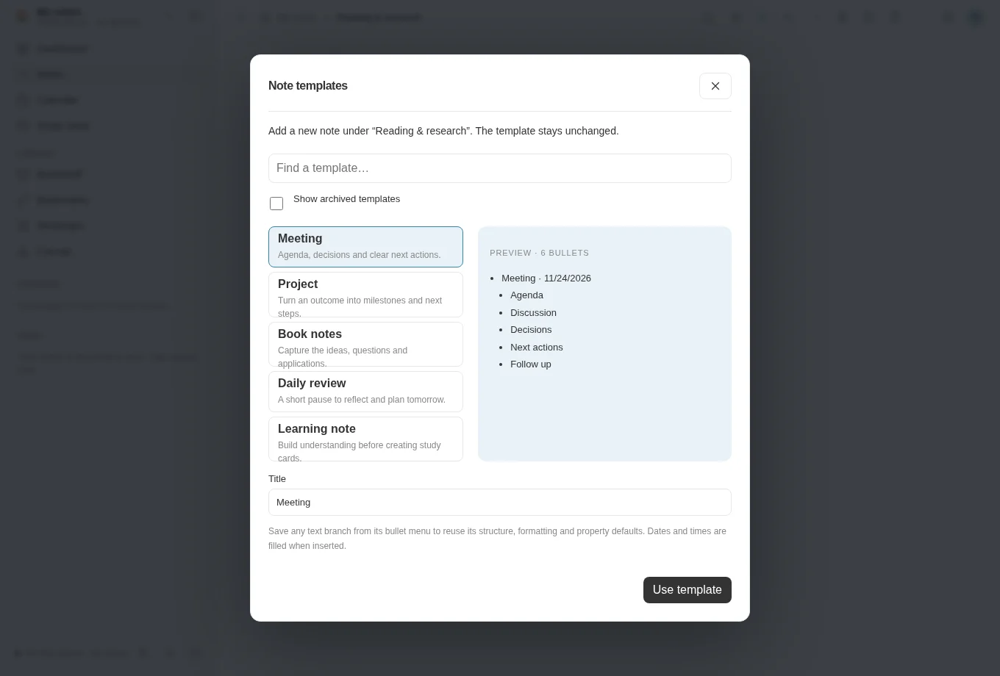
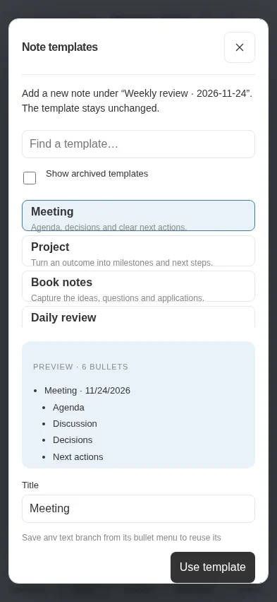
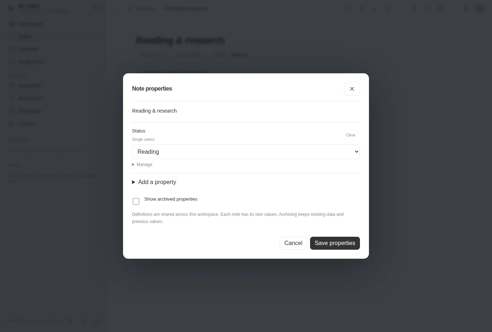
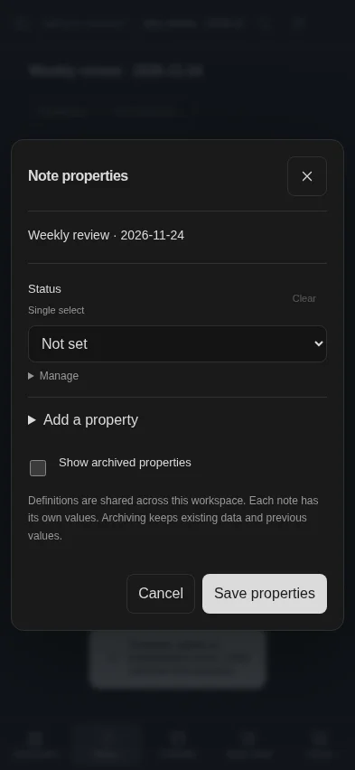

# Reusable note templates and typed properties

In web staging, properties are **[Traits](TRAITS.md)**: plain `Name: value` bullets under a
**Traits** bullet (type `#traits`). They travel with templates like any other bullet. The bullet
menu offers **Add traits**, **Use note template** and **Save as note template**.
The command palette also offers **New note from template**. Templates stay
available on ordinary notes through the menu. Native apps retain the previous UI
until their next authorized release.

Templates start with Meeting, Project, Book notes, Daily review and Learning note.
Save a text branch to create your own; edit an ordinary branch and choose an
existing template in Save as to publish a new version. Each insertion creates
independent IDs, appends after existing children and expands the destination.
Formatting, internal note links and typed defaults carry over; completed tasks
become unchecked and calendar dates/review history do not carry over. Insertions
use normal persistence and are one undo step. Variables include `{{date}}`,
`{{time}}` and arbitrary fields such as `{{title}}` or `{{author}}`.

This first version rejects branches with files, MCQs or image-occlusion cards,
with an explanation. It does not silently omit those contents. Template payloads
have immutable version IDs; archiving retains their full contents.

Properties support text, number, date, checkbox, single select, multi-select and
note links; web NookTraits also supports URL and date/time. Definitions belong to the workspace; values belong to the original
note (mirrors use its identity). Only modified fields are saved. Previous values
are available under Manage, including both sides of concurrent edits. Restoring
a previous value adds an edit rather than deleting history. Type changes and
option deletion are intentionally unavailable: they would invalidate existing
values. Archive/restore definitions instead. Unset, false and zero stay distinct.

Storage is under the existing `web` metadata: `noteTemplates` and
`noteProperties` (version 1), through normal save, backups and v3 synchronization.
Property cells and definition names use append-only revision maps with stable
edit IDs. Concurrent revisions converge deterministically without removing either
value. No new snapshot replacement, manual merge UI or outbox mechanism is used.
Limits: 64 active properties, 128 choices per select, 128 active saved templates,
300 bullets per template, 8,000 characters per text property.

## Browser review images

These are real local browser renders with synthetic notes, not product mockups.
The flow creates a typed selection field, saves it, inserts a template as children,
and checks desktop/mobile dialogs and the persisted dark theme.

| Desktop templates | Mobile templates |
| --- | --- |
|  |  |

| Desktop properties | Mobile properties in dark mode |
| --- | --- |
|  |  |
