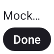
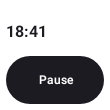
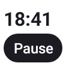
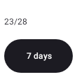
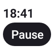
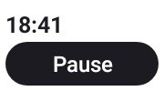
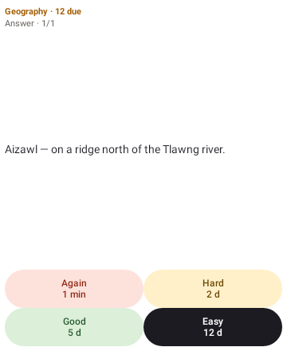
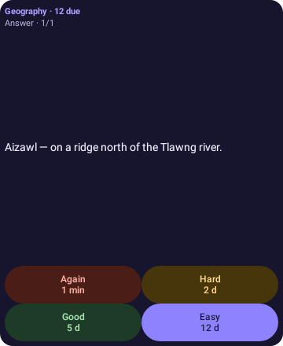

# Adaptive widgets and native actions

These are actual RemoteViews renders from synthetic notes in the API 33
Robolectric renderer, source `87ce245c501a0d59639e83d8c9e9ecd3da0a595b`.
[Native verification run](https://github.com/renx777/remonook/actions/runs/45319543425).
They are not physical-launcher captures. The tests also exercise API 28 resources
and actual durable event publication on Android API 28 and 33 emulators.

| 110 × 110 dp | Default text | 200% text |
| --- | --- | --- |
| Study |  |  |
| Today |  |  |
| Capture |  |  |
| Focus |  |  |
| Rhythm |  |  |
| Resurface |  |  |

Small layouts preserve their primary native action. Secondary actions/context
appear as space permits. Long study text is paged without dropping characters;
Next stays on one line and exposes progress to accessibility services. A small
revealed card offers grade selection and Other; larger cards show all four grades.

Focus also has regression captures at its 100 dp resize limit:

| 110 × 100 dp, 200% | 180 × 100 dp, 200% |
| --- | --- |
|  |  |

| Marigold revealed study | Electric Iris dark revealed study |
| --- | --- |
|  |  |

Study reveal/paging/grading, Today Done, Focus Start/Pause/End, Rhythm range and
Resurface Next run natively. Capture uses a small native input dialog. Photo and
voice review still open their existing app interfaces. Setup, locked, stale-cache
and genuine error states may require opening the app; they do not pretend to
complete an unavailable action. Old review evidence is never deleted.

The owner still needs to verify the update on their phone/launcher. These renders
do not prove OEM launcher sizing, system keyboard behavior or speech-provider
availability on a particular device.
