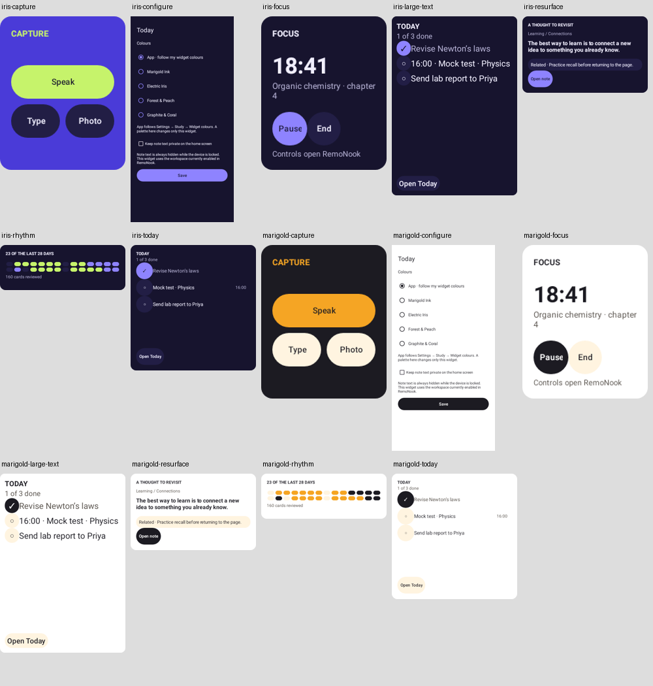

# Android widget suite — Phase 2

Actual native RemoteViews and configure Activity renders (Robolectric native
graphics, API 33). Source `94bde89d7436a60c47396b4cfd654785f52d9809`.
Synthetic data only. Individual WebP images are lossless conversions of the CI PNGs.

[Native verification #46](https://github.com/renx777/remonook/actions/runs/45282667880)
· [PNG screenshots and test reports](https://github.com/renx777/remonook/actions/runs/45282667880/artifacts/14870097395)

| View | Marigold Ink · light | Electric Iris · dark |
| --- | --- | --- |
| Today | [Full size](suite-marigold-today.webp) | [Full size](suite-iris-today.webp) |
| Quick capture | [Full size](suite-marigold-capture.webp) | [Full size](suite-iris-capture.webp) |
| Focus | [Full size](suite-marigold-focus.webp) | [Full size](suite-iris-focus.webp) |
| Study rhythm | [Full size](suite-marigold-rhythm.webp) | [Full size](suite-iris-rhythm.webp) |
| Resurface | [Full size](suite-marigold-resurface.webp) | [Full size](suite-iris-resurface.webp) |
| Configure | [Full size](suite-marigold-configure.webp) | [Full size](suite-iris-configure.webp) |
| Today at 200% text | [Full size](suite-marigold-large-text.webp) | [Full size](suite-iris-large-text.webp) |

Rendering tests also apply all five widgets in all four palettes in light/dark,
exercise legacy API 28 layouts, scope changes and locked messages, and check
minimum-size private messages at 200% font scale. Today’s time moves into the
main label at large font sizes to preserve the whole time. Compact Resurface
keeps the related-note preview and uses the whole card as its open target when
a separate button would not fit.

The Android filesystem jobs use real API 28/33 emulators for publication, fsync,
duplicate/colliding actions, archived-event replay and removal preserving saved
actions. These are distinct from the rendering screenshots.

Physical launcher placement/resizing, TalkBack, wallpaper colours, microphone/
photo handoff and end-to-end interaction on the owner’s phone remain device
checks. Focus uses the launcher’s system Chronometer; it can show overtime until
the next refresh and opens the app for timer controls. Voice/photo retain the
existing app sign-in requirements. Resurface needs meaning search enabled.
