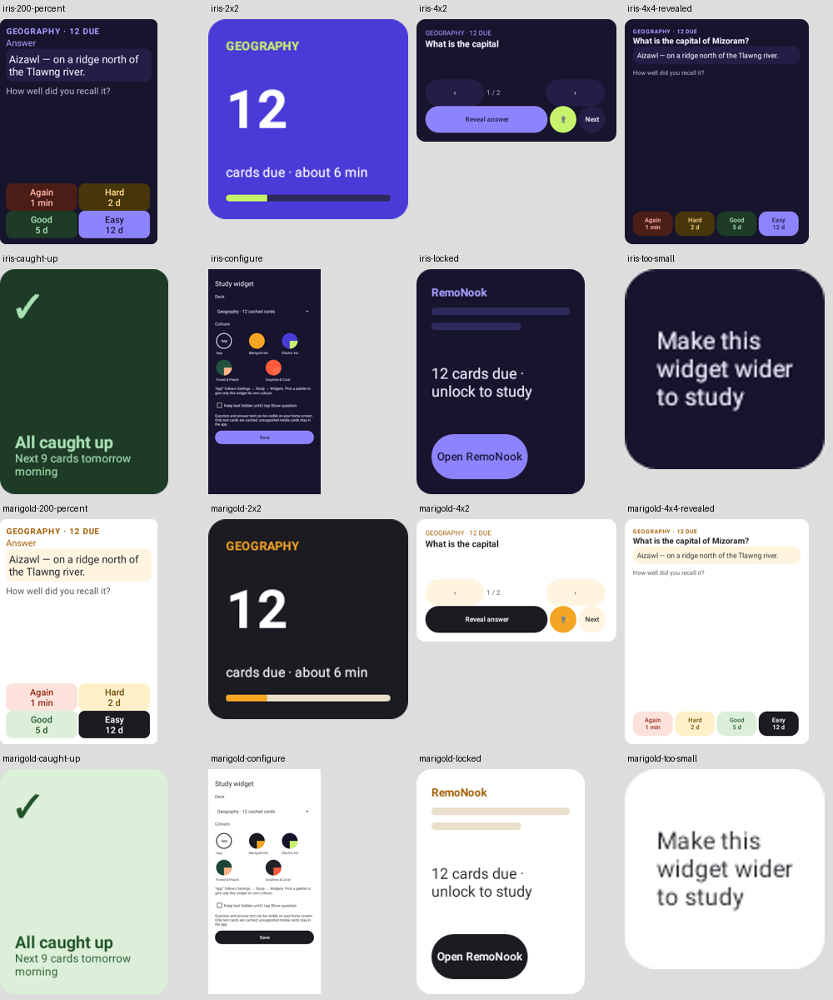

# Android Study widget Phase 1 screenshots

Actual Android RemoteViews and configuration activity rendered by Robolectric
(native graphics, API 33), not design mockups. Synthetic Geography data only.
Source: `252d9bf5b13d5b8a10f4931b306645904a5a5986`.

[Successful native and Rust verification](https://github.com/renx777/remonook/actions/runs/45162326204)
· [Original PNGs and test reports](https://github.com/renx777/remonook/actions/runs/45162326204/artifacts/14810973698).
The individual WebP files below are lossless conversions of those PNGs.
The contact sheet scales them for review.

| State | Marigold Ink · light | Electric Iris · dark |
| --- | --- | --- |
| 2×2 glance | [Screenshot](marigold-2x2.webp) | [Screenshot](iris-2x2.webp) |
| 4×2 prompt | [Screenshot](marigold-4x2.webp) | [Screenshot](iris-4x2.webp) |
| 4×4 revealed | [Screenshot](marigold-4x4-revealed.webp) | [Screenshot](iris-4x4-revealed.webp) |
| All caught up | [Screenshot](marigold-caught-up.webp) | [Screenshot](iris-caught-up.webp) |
| Private / locked | [Screenshot](marigold-locked.webp) | [Screenshot](iris-locked.webp) |
| Too small | [Screenshot](marigold-too-small.webp) | [Screenshot](iris-too-small.webp) |
| Configure | [Screenshot](marigold-configure.webp) | [Screenshot](iris-configure.webp) |
| 200% font scale | [Screenshot](marigold-200-percent.webp) | [Screenshot](iris-200-percent.webp) |

The prompt fixture intentionally exercises question paging. Long study text is
paged with the existing lossless pager rather than clipped. At 200% text the
full layout uses two grade rows. Legacy API 28 palette resources, palette
fallback, scope isolation, reapplication privacy, malformed caches and message
resizing are tested in the same suite.

Not physical-device acceptance: a real launcher, TalkBack, wallpaper colours and
the microphone permission/voice-review handoff still need checks on Android.
Explicit per-widget palettes use their own colours; App follows the app default
and its wallpaper-colour preference.
